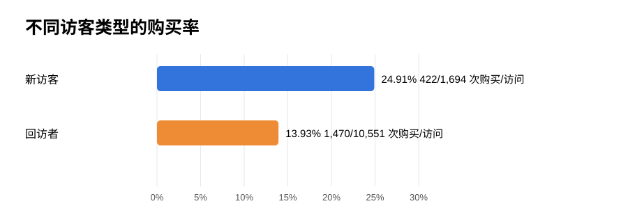
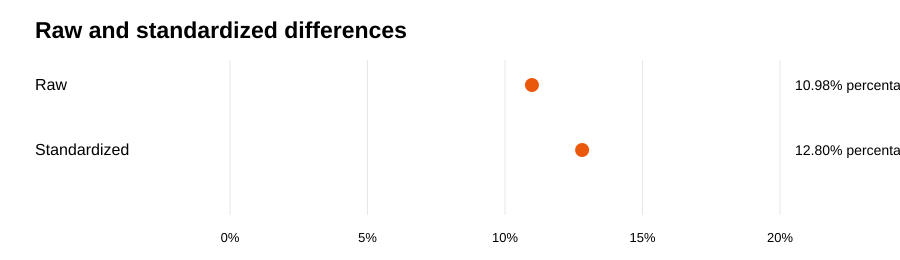

# INT6165 在线购物购买率分析

> Online Shoppers Purchase Rate Analysis


## 1. 项目简介

本项目为 INT6165 课程小组项目，基于在线购物行为数据，
研究新访客（New Visitor）与回访者（Returning Visitor）
之间的购买率差异。

通过条件概率、统计假设检验、置信区间估计及分组分析，
探讨访客类型与购买行为之间的统计关联。

## 2. 数据来源

数据集来自 UCI Machine Learning Repository：

[Online Shoppers Purchasing Intention Dataset](https://archive.ics.uci.edu/dataset/468/online+shoppers+purchasing+intention+dataset)

核心研究变量：

| 变量 | 含义 |
| --- | --- |
| VisitorType | 访客类型 |
| Revenue | 是否完成购买 |
| ProductRelated | 产品相关页面浏览数量 |

## 3. 技术栈

| 技术 | 用途 |
| --- | --- |
| Python | 数据处理与统计计算 |
| Pandas | 数据清洗、分组与数据分析 |
| Python 标准库 | 辅助计算与文件处理 |
| SVG / PNG | 数据可视化 |
| Git / GitHub | 版本管理与项目协作 |

## 4. 分析方法

- 数据质量检查与缺失值分析
- 条件概率与购买率计算
- 购买率及差值的置信区间估计
- 统计假设检验
- 产品页面浏览量分组分析
- 标准化购买率分析
- 重复数据敏感性分析

## 5. 项目结构

```text
INT6165-Online-Shoppers-Analysis/
├── data/
│   └── raw/
│       └── online_shoppers_intention.csv
├── src/
│   └── analyze_shoppers.py
├── outputs/
│   ├── charts/
│   └── tables/
├── README.md
├── RESULTS.md
└── requirements.txt
```

| 目录或文件 | 说明 |
| --- | --- |
| data/raw/ | 原始数据集 |
| src/ | Python 分析程序 |
| outputs/charts/ | 数据可视化图表 |
| outputs/tables/ | CSV 统计结果 |
| RESULTS.md | 详细统计结果与解释 |
| requirements.txt | Python 项目依赖 |

## 6. 运行方法

请先安装 Python 3，并在项目根目录执行以下命令。

### macOS / Linux

```bash
python3 -m venv .venv
.venv/bin/python -m pip install -r requirements.txt
.venv/bin/python src/analyze_shoppers.py
```

### Windows

```powershell
python -m venv .venv
.venv\Scripts\python.exe -m pip install -r requirements.txt
.venv\Scripts\python.exe src\analyze_shoppers.py
```

运行程序后：

- 自动更新 outputs/tables/ 中的 CSV 文件。
- 自动更新 outputs/charts/ 中的 SVG 图表。
- 不修改原始 CSV 数据集。
- 已有 PNG 图片不会自动更新。

## 7. 主要研究结果

| 访客类型 | 访问会话数 | 购买会话数 | 购买率 |
| --- | ---: | ---: | ---: |
| 新访客 | 1,694 | 422 | 24.91% |
| 回访者 | 10,551 | 1,470 | 13.93% |

新访客的购买率比回访者高约 **10.98 个百分点**。

进一步的统计检验、置信区间、分组分析及结果解释，
请参阅 [RESULTS.md](RESULTS.md)。

## 8. 数据可视化

### 新访客与回访者购买率对比



### 购买率置信区间


### 原始购买率与标准化购买率比较



## 9. 研究局限

- 数据以访问会话为单位，而非独立用户。
- 观察到的统计关联不能直接证明因果关系。
- 购买行为可能受到其他变量的影响。
- 研究结果的适用范围受到数据集本身的限制。

## 10. 项目用途

本项目用于 INT6165 课程学习、小组研究及统计分析实践。
