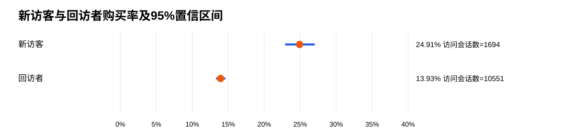

<div align="center">

# INT6165 在线购物购买率分析

### 新访客与回访者的购买行为比较

<p>
  
  
  
  
</p>

<p>使用公开在线购物访问数据，计算新访客与回访者的购买率，并通过区间估计、假设检验和分组分析理解观察到的差异。</p>

</div>

---

## 项目速览

| 项目 | 内容 |
|---|---|
| 研究问题 | 新访客与回访者的访问会话购买率是否不同？ |
| 数据集 | [UCI Online Shoppers Purchasing Intention Dataset](https://archive.ics.uci.edu/dataset/468/online+shoppers+purchasing+intention+dataset) |
| 数据规模 | 12,330 条访问会话、18 个字段 |
| 主要方法 | 条件概率、Wilson 置信区间、Newcombe 差值区间、双侧两比例 Z 检验、ProductRelated 分组比较 |
| 工具 | Python、pandas、SVG |
| 详细结果 | [RESULTS.md](RESULTS.md) |

## 核心发现

| 访客类型 | 访问会话数 | 购买会话数 | 购买率 |
|---|---:|---:|---:|
| 新访客 | 1,694 | 422 | **24.91%** |
| 回访者 | 10,551 | 1,470 | **13.93%** |

新访客的购买率高 **10.98 个百分点**。Newcombe 95% 置信区间为 **8.87–13.19 个百分点**；双侧两组比例 Z 检验为 **Z = 11.6053，p = 3.87 × 10⁻³¹**。在本数据中，两组访问会话的购买比例存在统计差异。

> **解释边界：**这是观察性数据。结果说明访客类型与购买行为有关联，不能据此断言访客类型导致购买率差异。数据以访问会话为单位，也没有用户 ID 来识别独立用户。

## 主要图表

### 新访客与回访者购买率


### 购买率及 95% 置信区间



### 购买率差值及 95% 置信区间


分组细图、标准化和贝叶斯图表见 [`outputs/charts/`](outputs/charts/)；逐步公式和结果解释见 [RESULTS.md](RESULTS.md)。

## 分析流程

```text
读取数据
  → 检查字段、缺失值与重复记录
  → 按访客类型计算访问数、购买数和购买率
  → 估计购买率及差值的 95% 置信区间
  → 进行双侧两比例 Z 检验
  → 按 ProductRelated 浏览量分组并比较
  → 输出 CSV 结果表与 SVG 图表
```

购买率定义为：

```text
购买率 = 购买会话数 ÷ 该组访问会话总数
```

每行代表一次访问会话，不代表一位独立访客。数据中有 0 个缺失值和 125 条完全相同记录。主分析保留重复记录，并在结果中提供去重敏感性比较；相同记录本身不足以证明数据错误。

## 项目结构

```text
INT6165-Online-Shoppers-Analysis/
├── data/
│   └── raw/                         # 原始数据；分析程序不会修改
├── src/
│   ├── analyze_shoppers.py          # 主分析：购买率、置信区间与分组比较
│   └── analyze_supplementary.py     # 补充分析：Logistic 回归与贝叶斯模型
├── outputs/
│   ├── charts/                      # SVG/PNG 图表
│   ├── tables/                      # CSV 统计结果
│   └── reports/                     # 补充分析报告 PDF
├── README.md                        # 项目主页与运行说明
├── RESULTS.md                       # 详细方法、公式、结果与局限
├── requirements.txt                 # Python 依赖
└── MarkingStandard.pdf              # 课程评分标准
```

分组深入分析和贝叶斯补充分析由 `src/analyze_supplementary.py` 统一复现，图表与 CSV 直接写入 `outputs/`。补充分析报告 PDF 保存在 `outputs/reports/`。

## 如何运行

### 环境要求

- Python 3
- 项目依赖见 [`requirements.txt`](requirements.txt)

在项目根目录打开终端，首次运行时创建项目专用环境并安装依赖：

```bash
python3 -m venv .venv
.venv/bin/python -m pip install -r requirements.txt
```

运行主分析：

```bash
.venv/bin/python src/analyze_shoppers.py
```

程序会读取 `data/raw/online_shoppers_intention.csv`，更新 `outputs/tables/` 中的主分析 CSV 和 `outputs/charts/` 中的主分析 SVG；不会改动原始数据。已有 PNG 不会自动更新。

### 运行补充分析

补充脚本读取同一份原始 CSV，生成 ProductRelated 分组区间图、Logistic 回归结果和 Beta-二项贝叶斯结果。依赖已列入 `requirements.txt`。如果已有 `.venv`，先更新依赖：

```bash
.venv/bin/python -m pip install -r requirements.txt
```

然后在项目根目录运行：

```bash
.venv/bin/python src/analyze_supplementary.py
```

脚本会把结果直接写入 `outputs/tables/` 与 `outputs/charts/`，不修改原始数据。

## 结果文件导航

| 文件 | 内容 |
|---|---|
| `outputs/tables/purchase_rate_by_visitor.csv` | 各访客类型的访问数、购买数和购买率 |
| `outputs/tables/stage2_confidence_intervals.csv` | 两组购买率及 Wilson 区间 |
| `outputs/tables/stage2_test.csv` | 差值、Newcombe 区间、Z 值和 p 值 |
| `outputs/tables/stage2_productrelated_groups.csv` | 主程序生成的浏览量分组汇总 |
| `outputs/tables/stage2_productrelated_detail.csv` | 补充脚本生成的分组计数、Wilson 区间与稀疏提示 |
| `outputs/tables/stage2_standardized.csv` | 原始购买率与标准化购买率 |
| `outputs/tables/stage2_duplicate_sensitivity.csv` | 保留与去重情景的敏感性比较 |
| `outputs/tables/stage2_logistic_coefficients.csv` | Logistic 回归系数、优势比及其区间 |
| `outputs/tables/stage2_logistic_diagnostics.csv` | Logistic 模型收敛与拟合诊断 |
| `outputs/tables/stage2_bayesian_posteriors.csv` | 两组购买率的后验结果 |
| `outputs/tables/stage2_bayesian_comparisons.csv` | 两种先验下购买率差值的后验比较 |

## 方法与研究限制

- **条件概率：** 按访客类型计算购买会话数占该类访问会话数的比例。
- **置信区间：** Wilson 区间用于单组比例；Newcombe 方法用于两组比例差。
- **假设检验：** 使用双侧两比例 Z 检验，判断两组购买率是否存在统计显著差异。
- **深入分析：** ProductRelated 分组比较、标准化、Logistic 回归和 Beta-二项贝叶斯分析作为补充证据，不能解释为因果效应。

研究结论受数据集范围和观察性设计限制：访问会话不等同于独立用户；访客类型不是随机分配；ProductRelated 是访问过程中产生的行为指标。完整解释与计算细节见 [RESULTS.md](RESULTS.md)。

## 技术栈

`Python` · `pandas` · Python 标准库 · `CSV` · `SVG`

本项目进行统计分析与可视化，**没有训练购买预测机器学习模型**。

---

<div align="center">

INT6165 · Foundations of Data Science and AI · Group Project

</div>
