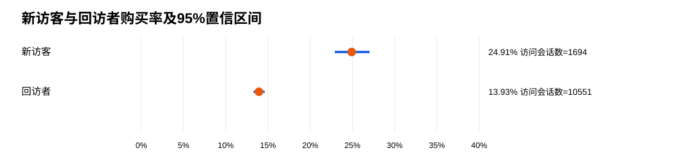
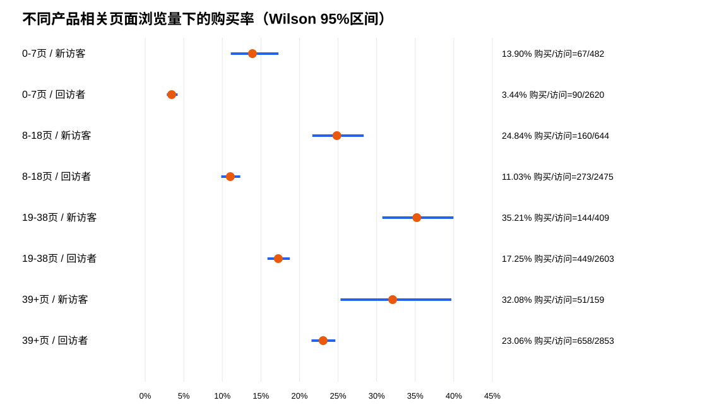
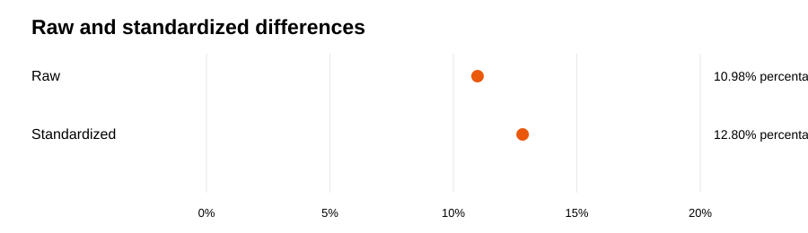
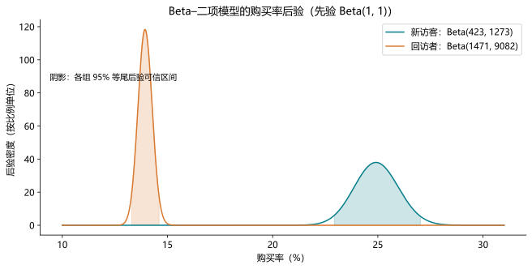
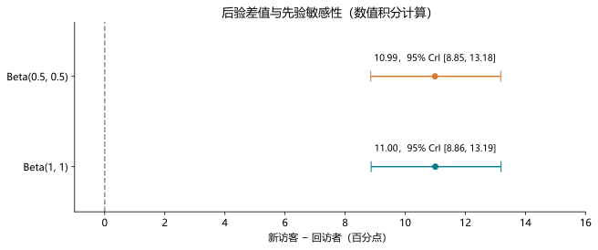

# INT6165 统计分析结果：新访客与回访者购买率

> 本文逐步说明做了什么、为什么做、结果如何解释。数字根据 `src/analyze_shoppers.py` 的实际输出整理。项目运行方法见 [README.md](README.md)。

---

## 一页速览

| 结果 | 新访客 | 回访者 |
|---|---:|---:|
| 访问会话 | 1,694 | 10,551 |
| 购买会话 | 422 | 1,470 |
| 购买率 | **24.91%** | **13.93%** |
| 95% 置信区间 | 22.91%–27.03% | 13.28%–14.61% |

**差值：10.98 个百分点** · **差值 95% 区间：8.87–13.19 个百分点** · **双侧检验 p=3.87×10⁻³¹**

> **结论边界：**数据支持两类访问会话购买比例有差异；观察性数据不能证明因果关系。

### 阅读导航

[研究问题](#1-研究问题和数据单位) · [购买率](#3-先算购买率) · [置信区间](#4-购买率的-95-置信区间) · [比例检验](#5-差值和比例检验) · [分组分析](#6-产品页面浏览量分组) · [Logistic 补充分析](#64-logistic-回归补充分析) · [敏感性分析](#7-重复记录敏感性分析) · [贝叶斯补充](#8-贝叶斯补充分析) · [结论](#9-结论与边界)

---

## 1. 研究问题和数据单位

研究问题：在这份在线购物数据中，新访客和回访者的购买率是否不同？差多少？差异是否可能只是样本波动？

数据来自 [UCI Online Shoppers Purchasing Intention Dataset](https://archive.ics.uci.edu/dataset/468/online+shoppers+purchasing+intention+dataset)，含 12,330 条访问会话和 18 个字段。一行代表一次访问记录，不一定代表一个不同的人。数据没有用户编号，因此无法确认同一人是否访问多次。

`Revenue=True` 表示本次访问购买；`False` 表示未购买。报告中的比例都以**访问会话**为单位。

---

## 2. 数据检查和比较范围

| 检查 | 结果 | 解释 |
|---|---:|---|
| 访问会话 | 12,330 | 数据行数 |
| 字段 | 18 | 每条记录中的变量数 |
| 缺失值 | 0 | 未发现空值 |
| 完全相同记录 | 125 | 所有字段内容都相同 |
| Other | 85 次访问、16 次购买 | 不属于两组研究对象 |

主分析保留 125 条完全相同记录。内容相同不能证明记录一定错误，所以不擅自删除；另做敏感性分析，检查删除后结果是否明显改变。Other 保留在数据记录中，但不加入新访客与回访者比较。

---

## 3. 先算购买率

$$\hat p=\frac{x}{n}$$

其中 \(x\) 是购买会话数，\(n\) 是该组总访问会话数，\(\hat p\) 是样本购买率。

$$\hat p_{\text{新访客}}=\frac{422}{1694}=24.91\%$$

$$\hat p_{\text{回访者}}=\frac{1470}{10551}=13.93\%$$

| 类型 | 访问数 \(n\) | 购买数 \(x\) | 购买率 |
|---|---:|---:|---:|
| 新访客 | 1,694 | 422 | 24.91% |
| 回访者 | 10,551 | 1,470 | 13.93% |

白话说，这份数据记录的新访客访问中，每 100 次约有 25 次购买；回访者每 100 次约有 14 次购买。它不是按不同人数计算的购买比例。

---

## 4. 购买率的 95% 置信区间

换一批访问记录，算出的购买率可能略有不同。置信区间给出这种样本不确定性的一段范围。经典解释是：如果同方法反复抽样，长期约 95% 的区间会覆盖总体购买率；不是说总体值有 95% 概率落在当前区间。

比例区间使用 Wilson 方法。令 \(\hat p=x/n\)、\(z=1.96\)：

$$
\frac{\hat p+\frac{z^2}{2n}\ \pm\
z\sqrt{\frac{\hat p(1-\hat p)}{n}+\frac{z^2}{4n^2}}}
{1+\frac{z^2}{n}}
$$

| 类型 | 购买率 | Wilson 95% 区间 |
|---|---:|---:|
| 新访客 | 24.91% | 22.91%–27.03% |
| 回访者 | 13.93% | 13.28%–14.61% |

区间越窄，估计通常越精确。新访客样本较少，所以它的区间较宽。若问题是两组差多少，要看差值区间。

---

## 5. 差值和比例检验

### 5.1 差多少？

差值定义为新访客率减回访者率：

$$24.91\%-13.93\%=10.98\text{ 个百分点}$$

百分点是两个百分比直接相减的单位，不等同于“相对增加 10.98%”。Newcombe 95% 差值区间为 **8.87–13.19 个百分点**，区间没有包含 0。

### 5.2 两组比例 Z 检验

检验的问题是：如果两类访客在总体中的购买概率其实相同，当前这么大的差异是否容易仅靠抽样波动出现？

- 原假设 \(H_0\)：两组总体购买概率相同。
- 备择假设 \(H_1\)：两组总体购买概率不同。
- 显著性水平 \(\alpha=0.05\)。
- 双侧检验：问题问“是否不同”，不预设方向。

先按原假设合并两组购买比例：

$$
\hat p_{\mathrm{合并}}=\frac{422+1470}{1694+10551}\approx0.154512
$$

再计算 Z：

$$
Z=\frac{\hat p_1-\hat p_2}
{\sqrt{\hat p_{\mathrm{合并}}(1-\hat p_{\mathrm{合并}})
\left(\frac1{n_1}+\frac1{n_2}\right)}}
$$

| 统计量 | 结果 |
|---|---:|
| 合并购买率 | 0.154512（约 15.45%） |
| 标准误 | 约 0.009460 |
| Z 值 | 11.6053 |
| 双侧 p 值 | \(3.87\times10^{-31}\) |

p 值远小于 0.05，因此按该检验的假设，拒绝“两组总体购买概率相同”的原假设。数据支持两组访问会话购买比例存在统计差异。

p 值不是“原假设为真的概率”，也不是“结果由偶然造成的概率”。它表示在原假设成立且检验条件满足时，出现当前或更极端结果的概率。

检验假设会话近似独立；但没有用户编号，无法排除同一用户有多次访问，所以显著性结果要结合此限制解释。

---

## 6. 产品页面浏览量分组

### 6.1 如何分组？

`ProductRelated` 是一次访问中浏览的产品相关页面数。将新访客和回访者的访问合并，计算第 25、50、75 百分位，得到 7、18、38 页的边界。于是分为 0–7、8–18、19–38、39+ 四组。两类访客使用同一组边界，才能做相同范围的比较。

### 6.2 分组购买率

| 页面数 | 新访客购买/访问 | 新访客率 | 回访者购买/访问 | 回访者率 | 差值 |
|---|---:|---:|---:|---:|---:|
| 0–7 | 67/482 | 13.90% | 90/2,620 | 3.44% | 10.47 个百分点 |
| 8–18 | 160/644 | 24.84% | 273/2,475 | 11.03% | 13.81 个百分点 |
| 19–38 | 144/409 | 35.21% | 449/2,603 | 17.25% | 17.96 个百分点 |
| 39+ | 51/159 | 32.08% | 658/2,853 | 23.06% | 9.01 个百分点 |

同一分组的购买率区间使用 Wilson 95% 方法。下表把组员深入检查中的 8 个区间补入主结果；购买数和会话数与上表相同。

| 页面数 | 新访客 Wilson 95% 区间 | 回访者 Wilson 95% 区间 |
|---|---:|---:|
| 0–7 | 11.10%–17.28% | 2.80%–4.20% |
| 8–18 | 21.66%–28.32% | 9.86%–12.33% |
| 19–38 | 30.74%–39.95% | 15.85%–18.75% |
| 39+ | 25.32%–39.68% | 21.55%–24.64% |

最小分组是 39+ 页的新访客：159 次访问、51 次购买、108 次未购买。按照“会话数少于 30，或购买数/未购买数小于 5”的提示规则，八个单元都没有触发稀疏提示。区间分别描述每个单元的估计不确定性，不是四组差值的同时区间；这里不把八个区间当作八次显著性检验。

四个组中，新访客购买率均高于回访者。数据不是每组都递增，不能说浏览越多就一定越会买。

### 6.3 标准化比较

两类访客在四个浏览量组中的人数比例不同，可能影响总体购买率。标准化是给两类访客都使用相同的组权重，再计算加权率；它是描述性调整。

每个组 \(s\) 的共同权重：

$$w_s=\frac{n_{\text{新},s}+n_{\text{回访},s}}{12245}$$

12,245 = 1,694 + 10,551，是两类访问数总和，不含 Other。组权重相加为 1。

访客类型 \(g\) 的标准化率：

$$\hat p_g^*=\sum_s w_s\frac{x_{g,s}}{n_{g,s}}$$

| 指标 | 原始率 | 标准化率 |
|---|---:|---:|
| 新访客 | 24.91% | 26.40% |
| 回访者 | 13.93% | 13.60% |
| 两组差值 | 10.98 个百分点 | 12.80 个百分点 |

按共同浏览量分布加权后，描述性差异仍然存在，差值为 12.80 个百分点。

这不是因果控制：ProductRelated 是访问期间形成的行为，可能与购买意愿或购买过程相关。分组和标准化不能证明访客类型造成购买差异，也无法排除其他因素。

---

### 6.4 Logistic 回归补充分析

这部分来自组员提供的任务 7 脚本，是对同一批会话数据的模型补充。它把购买记为 1、未购买记为 0，估计在指定浏览量调整方式下，新访客与回访者购买优势（odds）的关联。

| 调整方式 | 新访客 OR | 95% 区间 | p 值 |
|---|---:|---:|---:|
| ProductRelated 四组 | 2.639 | 2.314–3.010 | 2.075×10⁻⁴⁷ |
| log(1+ProductRelated) | 2.780 | 2.440–3.166 | 2.309×10⁻⁵³ |

OR 是优势比，不是购买率倍数，也不是百分点差。两个模型均未加入访客类型与浏览量的交互项，只调整了页面浏览量，没有控制其他变量。ProductRelated 是访问过程中形成的行为，因此这些结果只能作为指定模型下的关联描述，不能证明访客类型造成购买差异，也不能当作预测模型。会话可能来自同一用户，独立性也无法由当前数据确认。

系数明细见 [`stage2_logistic_coefficients.csv`](outputs/tables/stage2_logistic_coefficients.csv)。复现代码集中在 [`src/analyze_supplementary.py`](src/analyze_supplementary.py)，运行后生成对应 CSV 和分组图。

---

## 7. 重复记录敏感性分析

为了看 125 条完全相同记录是否明显影响结果，另算一个版本：只在敏感性分析中删去完全相同的行，再重算购买率。

| 处理 | 新访客购买/访问 | 新访客率 | 回访者购买/访问 | 回访者率 | 差值 |
|---|---:|---:|---:|---:|---:|
| 主分析：保留 | 422/1,694 | 24.91% | 1,470/10,551 | 13.93% | 10.98 个百分点 |
| 敏感性：去重 | 422/1,693 | 24.93% | 1,470/10,431 | 14.09% | 约 10.83 个百分点 |

差值接近，说明描述结果对这个处理选择不太敏感；但不能因此证明去重或保留哪种方式绝对正确。主分析仍保留记录。

---

## 8. 贝叶斯补充分析

贝叶斯部分由组员补充，使用同一批新访客和回访者访问记录，换一个统计框架估计购买率与两组差值。它是方法补充，不是新数据，也不是独立重复验证。

### 8.1 Beta–二项更新

令每类访客的购买概率为 \(p\)，购买会话数为 \(x\)，总会话数为 \(n\)。设先验 \(p\sim\mathrm{Beta}(a,b)\)，观测购买/未购买结果后：

$$p\mid\text{数据}\sim\mathrm{Beta}(a+x,\ b+n-x)$$

主分析使用均匀先验 \(\mathrm{Beta}(1,1)\)。例如新访客有 422 次购买、1,272 次未购买，所以后验是 \(\mathrm{Beta}(1+422,1+1272)=\mathrm{Beta}(423,1273)\)。

| 访客 | 后验分布 | 后验均值 | 95% 后验可信区间 |
|---|---|---:|---:|
| 新访客 | Beta(423, 1273) | 24.94% | 22.91%–27.03% |
| 回访者 | Beta(1471, 9082) | 13.94% | 13.28%–14.61% |

### 8.2 两组差值与先验敏感性

定义差值 \(\Delta=p_{新访客}-p_{回访者}\)。在 Beta(1,1) 先验下，差值后验均值为 **11.00 个百分点**，95% 后验可信区间为 **8.86–13.19 个百分点**。后验概率 \(P(p_{新访客}\le p_{回访者}\mid数据)\approx2.11\times10^{-28}\)，所以在该模型和先验下，\(P(p_{新访客}>p_{回访者}\mid数据)>99.9999\%\)。这不是频率学派的 p 值，也不表示绝对确定。

| 先验 | 差值后验均值 | 差值 95% 可信区间 |
|---|---:|---:|
| Beta(1,1) | 11.00 个百分点 | 8.86–13.19 |
| Beta(0.5,0.5)（Jeffreys） | 10.99 个百分点 | 8.85–13.18 |

两种先验下方向与数值接近，说明这次结果对这两种先验选择不敏感；这不等于检验了所有可能先验。95% 后验可信区间的解释是：在给定模型、先验和数据后，参数落在该区间的后验概率为 95%。它和频率学派置信区间的长期重复抽样解释不同。

贝叶斯补充也按访问会话近似独立处理，没有用户编号，也没有按 ProductRelated 调整，因此不能作因果结论。组员原说明中引用的频率学派差值区间是旧数值；本项目以主程序当前输出为准，即 Newcombe 95% 区间 **8.87–13.19 个百分点**（见第 5 节）。

后验表和差值表分别见 [`stage2_bayesian_posteriors.csv`](outputs/tables/stage2_bayesian_posteriors.csv) 与 [`stage2_bayesian_comparisons.csv`](outputs/tables/stage2_bayesian_comparisons.csv)。复现代码集中在 [`src/analyze_supplementary.py`](src/analyze_supplementary.py)，运行后生成对应 CSV 和图表。

---

## 9. 结论与边界

汇报时可以说：

> 在该数据集记录的访问会话中，新访客购买率为 24.91%，回访者为 13.93%，差值为 10.98 个百分点。差值的 95% 区间为 8.87–13.19 个百分点，比例检验支持两组存在统计差异。按产品页面浏览量分组后，各组新访客购买率仍较高。由于数据是观察性会话记录，无法识别独立用户，所以不能据此证明因果关系。

可以得出的结论：本数据中的比例、差值、区间、检验和分组描述。不能得出的结论：访客类型导致差异、会话等于不同用户、重复记录一定错误、结果适用于所有网站或时期。

---

## 10. 输出文件

运行 `.venv/bin/python src/analyze_shoppers.py` 可生成主分析结果；再运行 `.venv/bin/python src/analyze_supplementary.py` 可生成分组深入分析、Logistic 回归和贝叶斯补充结果。CSV 表格统一写入 `outputs/tables/`，图表写入 `outputs/charts/`。补充分析 PDF、LaTeX 源文件与配图保存在 `outputs/reports/`。

- `stage2_confidence_intervals.csv`：两组购买率和 Wilson 区间。
- `stage2_test.csv`：检验、p 值和差值区间。
- `stage2_productrelated_groups.csv`：四个浏览量组的购买数、未购买数、购买率、Wilson 95% 区间和稀疏样本提示。
- `stage2_productrelated_detail.csv`：分组计数、Wilson 区间及稀疏提示。
- `stage2_logistic_coefficients.csv`：Logistic 模型系数及 OR 区间。
- `stage2_logistic_diagnostics.csv`：模型收敛和数值诊断。
- `stage2_bayesian_posteriors.csv`、`stage2_bayesian_comparisons.csv`：两组后验及差值结果。
- `stage2_group_weights.csv`、`stage2_standardized.csv`：标准化权重和结果。
- `stage2_duplicate_sensitivity.csv`：保留和去重后的对照结果。

本地文件不会自动同步到飞书；若需展示，上传或插入图表。

---

*INT6165 · 统计分析结果*
